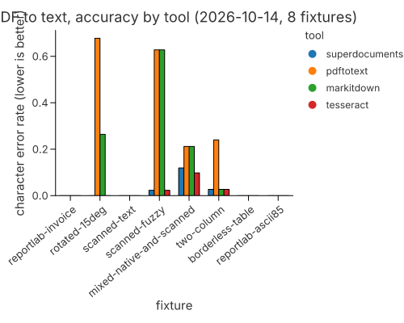
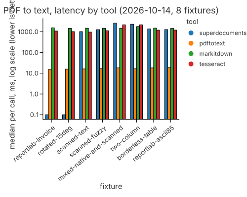
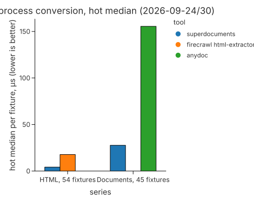
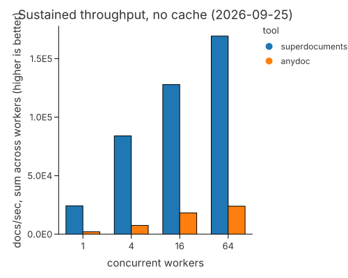
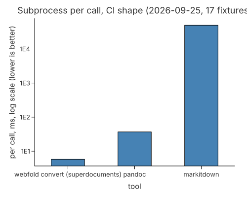

<div align="center">

# superdocuments

**Every document an AI pipeline meets, converted to Markdown and structured data by one Rust crate.**

[](https://github.com/webfold-ai/superdocuments/actions/workflows/ci.yml)
[](LICENSE)
[](Cargo.toml)

[Formats](docs/FORMATS.md) · [Architecture](docs/ARCHITECTURE.md) · [Benchmarks](#benchmarks) · [Changelog](CHANGELOG.md) · [Contributing](CONTRIBUTING.md)

</div>

`superdocuments` reads DOCX, DOCM, PPTX, XLSX, XLSM, XLS, XLSB, ODT, ODP, ODS, EPUB, RTF, CSV, HTML, LaTeX, BibTeX and arXiv e-prints, and turns them into Markdown or structured Rust types — in process, with no GPU, no model downloads and no Python. PDF text extraction is native (with an optional OCR fallback through `pdftoppm` and `tesseract`); legacy binary `.xls` is read through the in-repo `calamine/` fork. It is the conversion engine behind [`webfold`](https://github.com/webfold-ai/webfold), which re-exports it.

> **Status: research build (0.9.0).** Not production-ready. Interfaces, formats and results may change without notice while the crate is hardened toward a production release. Known gaps are listed [below](#known-gaps).

## Quick start

```toml
[dependencies]
superdocuments = { git = "https://github.com/webfold-ai/superdocuments", tag = "v0.9.0" }
```

```rust
// Any supported format, routed by extension:
let markdown = superdocuments::document::convert_bytes("docx", bytes)?;
// Or from a path:
let markdown = superdocuments::document::convert_path(std::path::Path::new("slides.pptx"))?;
// Structured access instead of Markdown:
let sheets = superdocuments::xlsx::read_workbook(bytes)?; // Vec<Worksheet { index, name, rows }>
let book = superdocuments::epub::read(bytes)?;            // Book { manifest, spine, title }
```

Run the converter locally without writing code:

```sh
git clone https://github.com/webfold-ai/superdocuments
cd superdocuments
cargo run --example sd_convert -- tests/fixtures/office/basic.docx
```

## Why one crate for this

Document conversion in an agent or RAG pipeline usually means one of three shapes, each with a cost:

- **Shelling out** to pandoc or MarkItDown per file: process startup dominates. On the same 17-fixture corpus, a subprocess call measured 5.8 ms for `webfold convert`, 37 ms for pandoc 3.1.11.1 and 49.8 s for MarkItDown 0.1.8 — which is 724× slower, dominated by Python startup ([method and caveats](#benchmarks)).
- **GPU document-AI** (marker, MinerU, docling): gigabytes of weights per tool, GPU capacity to serve them, and documents leaving the machine unless you self-host the stack.
- **Copyleft or commercial licences** in the middle of a proprietary pipeline: pandoc and Poppler are GPL, PyMuPDF is AGPL-or-commercial, marker's weights are OpenRAIL-M with commercial thresholds.

`superdocuments` is the fourth shape: one Apache-2.0 crate, linked into your process, converting Office/ODF/EPUB/RTF/CSV/HTML/LaTeX/PDF-text in microseconds per call, with a repeat-read cache for the same bytes. No GPU, no weights, no network, no data egress. Each format is weaker than the best specialist somewhere — the [format matrix](#format-matrix) says where, per row.

## What it does

**Office and ODF documents** — DOCX/DOCM (headings, lists, bold/italic, hyperlinks, nested tables, footnotes and endnotes), PPTX (slides in presentation order, body, tables, speaker notes), XLSX/XLSM (sheet names in tab order, dates from number formats, rich strings), XLSB (cached cells and shared strings), legacy XLS (BIFF via the in-repo `calamine/` fork), ODT/ODP/ODS. `document::extract_images` returns the embedded pictures of all of the above with media type, size and alt text.

**PDF** — native in-process text extraction to Markdown (`pdf::extract_markdown`, page-wise or whole file), embedded-image listing and bytes (`pdf::extract_images`; JPEG unchanged, Flate re-encoded as PNG), outline, and a JSON geometry side-channel. Optional OCR fallback calls external `pdftoppm` + `tesseract` for scanned pages.

**Web and markup** — HTML to Markdown in one pass over the bytes with no DOM tree (`html::to_blocks`, `html::to_markdown`); EPUB via manifest and spine; CSV with delimiter guessing and BOM handling; RTF read/write with code-page handling (Mac Roman, Shift_JIS, GBK, Big5, EUC-KR and more); reStructuredText to Pandoc-flavoured Markdown (`rst`, with sections, list types, grid and simple tables, directives and roles).

**Research formats** — a bounded LaTeX reader (`latex::parse` → sections, lists, tables, math kept as TeX, figures with captions and labels), BibTeX/BibLaTeX (`bibtex::parse` → `Bibliography`, round-trip writer, CSL-JSON export), arXiv e-print tarballs (`arxiv_source::read_eprint` → document, bibliography, figure image bytes; no network), and MathML to TeX.

**Structured APIs, not just Markdown** — parsers return typed data first: `Worksheet`, `RtfDocument`, `latex::Document`, `Bibliography`, `Book`, `HtmlDocument`, and `graph::DocumentGraph` (a document-level graph with reading order) for the PDF path.

**Repeat-read caching and streaming** — `DocumentCache::convert` keys a lifted document by a caller-supplied identity and renders Markdown straight to a `Write` sink on cache hits; `convert_streaming` is the one-shot write-through path. See the [cache benchmark](#benchmarks).

## Benchmarks

Measured, not claimed. The harness is [`webfold-bench`](https://github.com/webfold-ai/webfold-bench) (private); every fixture corpus named below is public, and every number comes from a committed result JSON with a provenance record. The conversion tracks were measured through `webfold`, which re-exports superdocuments' `html` and `document` modules unchanged — the code measured is this crate's. Charts are regenerated from the same tables by `benches/readme-charts` (charton).

### PDF to text, side by side with the incumbents

Eight public fixtures, five tools, one harness: quality (character error rate against ground truth, lower is better) and median wall time per call (log scale). Run 2026-10-14 on superdocuments `786e8bd`, tesseract 5.3.4, pdftotext 24.02.0.





| Fixture | superdocuments | pdftotext | markitdown | tesseract |
|---|---|---|---|---|
| reportlab-invoice | **0.1 ms, 0.000** | 15.4 ms, 0.000 | 1548 ms, 0.000 | 1086 ms, 0.000 |
| rotated-15deg | **0.1 ms, 0.000** | 15.9 ms, 0.678 | 1473 ms, 0.264 | 1018 ms, — |
| scanned-text | 1014 ms, **0.000** | 16.2 ms, — | 1478 ms, — | 967 ms, 0.000 |
| scanned-fuzzy | 1264 ms, **0.023** | 16.7 ms, 0.628 | 1479 ms, 0.628 | 1121 ms, 0.023 |
| mixed-native-and-scanned | 2606 ms, 0.119 | 18.2 ms, 0.212 | 1481 ms, 0.212 | 2164 ms, **0.098** |
| two-column | 2311 ms, **0.027** | 16.4 ms, 0.240 | 1781 ms, 0.027 | 2166 ms, 0.027 |
| borderless-table | 1378 ms, **0.000** | 18.2 ms, 0.000 | 1497 ms, 0.000 | 1201 ms, 0.000 |
| reportlab-ascii85 | 1275 ms, **0.000** | 19.1 ms, 0.000 | 1450 ms, 0.000 | 1203 ms, 0.000 |

Cells are `median wall time, CER`. The shipped route is native parser first, OCR fallback when native finds nothing. `—` means the tool produced no text on that fixture. Honest reading, from the source report: the native parser alone reads 2 of the 8; the other 6 pay OCR at roughly raw-tesseract cost (1.0–2.6 s), and 3 of those 6 are born-digital files a native parser should read — a tracked gap. CER is alphanumeric-lowercase only (no reading-order or table scoring), and these are 8 small fixtures, not large real-world PDFs.

### In-process conversion latency

Hot median per fixture, CPU-pinned (i9-14900KF, one logical core), 2026-09-24/30:



| Corpus (public fixtures) | Tool | Hot median | Quality |
|---|---|---:|---|
| HTML, 54 fixtures ([firecrawl/html-extractor](https://github.com/firecrawl/html-extractor) `0a2b743`) | superdocuments (via webfold `60ac8ce`) | **4.1–4.3 µs** | 1.000 mean on the 52 asserted fixtures |
| | Firecrawl html-extractor | 17.5–17.9 µs | 1.000 mean |
| Documents, 45 fixtures ([firecrawl/anydoc](https://github.com/firecrawl/anydoc) `261fc25`) | superdocuments (via webfold) | **27.7 µs** | 45/45 completed |
| | anydoc | 155.5 µs | 45/45 completed |

The HTML numbers are permissive assertion parity (expected lines found, forbidden strings absent), not byte-identical Markdown. The document numbers are conversion success, **not** a fidelity score — anydoc's public snapshots expose real superdocuments gaps (DOCX/PPTX math to LaTeX, table merges, EPUB spine order); see the format matrix.

### Throughput under concurrency

Sustained docs/sec, sum across workers, high-repeat workload, 2026-09-25:



| Tool | 1 worker | 4 | 16 | 64 |
|---|---:|---:|---:|---:|
| superdocuments, no cache (`convert_bytes`) | 24,302 | 84,024 | 127,832 | 169,282 |
| anydoc | 2,093 | 7,484 | 18,262 | 23,948 |
| superdocuments, cache + caller identity | 693,066 | 2,322,416 | 4,086,768 | 15,522,748 |
| superdocuments, cache + caller BLAKE3 | 805,182 | 2,536,726 | 3,150,191 | 26,646,157 |

The cached rows are the warm path — they require the same document to be converted more than once, which is what a server serving repeat requests executes, and are off the chart's linear scale. Peak RSS at 64 workers: ~18 MiB (cached) vs ~78 MiB (anydoc).

### Repeat-read cache

Warm-path speedup of `DocumentCache::convert` over `convert_bytes`, 17 streaming fixtures, 2026-09-25: median 3.6× (CSV), 4.0× (XLSX), 5.1× (DOCX) per format family, per-fixture range 3.5×–11.8×. Honest reading: the cold path with a cache is a small regression on tiny files (<10 KB) — the BLAKE3-class identity plus table probe costs more than a microsecond parse. The win is the warm path, and it holds byte-identical output to `convert_bytes` (tested).

### Subprocess shape (what CI scripts see)

Single call, subprocess per call, 17 fixtures, 2026-09-25:



| Tool | Per call | vs `webfold convert` |
|---|---:|---:|
| `webfold convert` (superdocuments inside) | **5.8 ms** | — |
| pandoc 3.1.11.1 | 37 ms | 6.6× slower |
| MarkItDown 0.1.8 | 49,800 ms | 724× slower |

MarkItDown's number is dominated by Python startup in the one-shot-subprocess shape; a long-running MarkItDown service would be faster per call. In-process (the server shape) superdocuments converts the same corpus in 2.7 µs.

### Parser correctness, measured in this repo

- The BibTeX and LaTeX readers were checked with 30 and 29 hand-made mutants (BibTeX 30/30 detected; LaTeX 27 detected, 2 equivalent) — [`benches/mutants/`](benches/mutants/).
- Against pandoc 3.1.3 on 16 LaTeX and 5 BibTeX fixtures, structural counts agree except one starred figure environment; pandoc fails on three BibTeX inputs — [`benches/latex-vs-pandoc/`](benches/latex-vs-pandoc/).
- `pdf::extract_images` image listings agree with poppler's `pdfimages` on the PDF fixtures — [`benches/pdf-images/`](benches/pdf-images/).

OCR quality/latency against inference-stack targets (marker, docling, surya, liteparse, PaddleOCR-VL via gateways) is measured in the companion harness [`superdocuments-bench`](https://github.com/webfold-ai/superdocuments-bench) (private), on the same fixture substrate; its published runs will be quoted here with the same discipline as the table above.

## Format matrix

Full detail — what each path reads, what comes out, the evidence behind each claim and the limits — is in [docs/FORMATS.md](docs/FORMATS.md). The matrix as of 0.9.0:

<details>
<summary><strong>Formats, outputs and known limitations (from reading the source; the test suite was not run when this table was first prepared)</strong></summary>

| Format | Markdown | Structured output | Images | OCR | Known limitations |
|---|---|---|---|---|---|
| DOCX, DOCM | `document::convert_bytes` / `convert_path` / `convert_streaming` | None public | `document::extract_images` returns the pictures (name, media type, size, first referencing part, alt). Markdown shows each one as `` where its drawing is | No | Headings from the document's styles (outline level, `heading N`, `Title`), bullet and numbered lists, bold and italic, hyperlinks with targets, tables (`gridSpan`, `vMerge`, nested tables flattened), footnotes and endnotes; tracked deletions omitted. Chart and diagram text is appended. Not read: headers, footers, comments, list start overrides, underline, colour. Tested with python-docx, LibreOffice and hand-built XML; no Word-written file |
| PPTX | `convert_bytes`, `convert_streaming` | None public | `extract_images` returns the pictures, with the slide that places them. Markdown shows each as `` in its slide | No | Slides in presentation order (`sldIdLst`), numbered by position, under `## Slide N: Title`. Body paragraphs, explicit bullets, hyperlinks, tables and speaker notes; footers, dates and slide numbers dropped. Not read: charts, SmartArt, comments, bullets that only the layout supplies. Tested with python-pptx and LibreOffice; no PowerPoint-written file |
| XLSX, XLSM | `convert_bytes`, `convert_streaming` | `xlsx::read_workbook`, `xlsx::read_sheet` return `Worksheet { index, name, rows }` | `extract_images` (pictures in drawings, then `xl/media`). Not in the Markdown | No | Sheets use the workbook's names in tab order (`Sheet N` only without a workbook part). Dates and times follow the cell's number format (1900 and 1904 epochs), booleans are `TRUE`/`FALSE`, inline and rich strings are read, uncalculated formulas show as `=formula`. Numbers are shown as their number format shows them: `General` and fixed decimals after Excel's rounding to 15 significant digits (`4.0999999999999996` shows `4.1`), thousands separators, percent, quoted/escaped literals, sections, and date and time codes (`mmm-yyyy` shows `Sep-2026`). Not implemented, and shown as stored (dates in ISO form): conditions, fractions, scientific notation, eras and the locale-dependent built-in formats (ids 14, 22, 27 to 36, 41 to 44, 50 to 58). `xlsx::read_workbook_typed` returns each cell's display text and typed value (`CellValue`: number with its stored text, date serial with its ISO form, ...). Not read: merged cells, hidden state, comments, charts. Tested with openpyxl and LibreOffice; no Excel-written file |
| XLSB | `convert_bytes` | None public | Not extracted | No | Cached scalar cells and shared strings only; formulas and styles are not reconstructed (comment in `document.rs`). Sheet names read from `xl/workbook.bin` |
| XLS (legacy) | `convert_bytes`, `convert_streaming` | None public | Not extracted | No | Same Markdown shape as XLSX: `## <sheet>` per worksheet in tab order, error cells as Excel error text (`#DIV/0!`), booleans, formula results (the stored value). Dates and times follow the cell's format as calamine classifies it. Charts and chart sheets are skipped, hidden sheets are kept. Tested with LibreOffice output (checked against its XLSX export) and calamine's BIFF fixtures; no Excel-written file |
| DOC, DOT (legacy Word) | `convert_bytes`, `convert_path` (`doc::convert`) | None public | Not extracted | No | The main story's text from the OLE compound file: Word 97-2003 piece table (8-bit and UTF-16 pieces), Word 6/95 by its text range, field results without field instructions, table cells as Markdown tables (a row ends at an empty cell mark, so a row whose last cells are empty can merge with the next). No styles, so no headings, lists or emphasis; headers, footers, footnotes, text boxes, comments and pictures are not read. Encrypted files and OLE files that are not Word documents give a named error. The content is sniffed: RTF and OOXML saved as `.doc` go to their readers. Tested on the Register's 21 `.doc` downloads (7 are OLE and use this reader, 14 are OOXML under a `.doc` name and go to the DOCX reader) against LibreOffice's text export |
| ODT, ODP | `convert_bytes` (same reader for both) | None public | `extract_images` (`Pictures/`, alt from `svg:desc`). Not in the Markdown | No | `text:p` and `text:h` only; every heading becomes `##`. No list, table or image handling in the code. ODP slides are not separated |
| ODS | `convert_bytes` | None public | `extract_images` (`Pictures/`). Not in the Markdown | No | One `## <table name>` section per sheet. Repeated empty columns are capped at 16,384. A cell that carries a typed value (`office:value`, `office:date-value`, ...) is read from the attribute alone; the display text in its `text:p` is ignored. Before this was fixed, such a cell came out twice (42 as 4242) |
| EPUB | `convert_bytes` (every `.xhtml`/`.html` entry, sorted by file name); `epub::extract_text` (spine order) | `epub::read` returns a `Book` (manifest, spine, title) | Image references as `` in the Markdown; `extract_images` returns each manifest image with the XHTML document that shows it | No | `convert_bytes` does not follow the spine. `epub::read` requires `META-INF/container.xml`. No CSS, fonts, scripting or DRM handling ([docs/EPUB.md](docs/EPUB.md)) |
| RTF | `convert_bytes`; `rtf::parse`, `rtf::to_text`, `rtf::to_markdown`, `rtf::to_rtf`, `rtf::markdown_to_rtf` | `rtf::RtfDocument`: metadata, blocks (paragraph, list item, table), hyperlinks, footnotes, optional headers and footers, warnings | Pictures (`\pict`, `\shppict`) are skipped; `\object` shows its `\result` | No | Bold, italic, strike, headings (outline level, style or large bold text), lists from `\listtext`, nested tables, `HYPERLINK` fields, footnotes, code pages from `\ansicpg`, `\fcharset` and `\cpg` (including Mac Roman, Shift_JIS, GBK, Big5, EUC-KR and UTF-8 escapes). Not supported: underline and colour in Markdown, font names, revision marks, fields other than `HYPERLINK`, right-to-left reordering, numbering without `\listtext` (shown as bullets), Symbol-font glyphs other than the bullet, and code pages `encoding_rs` lacks (reported as warnings). Bad headers and exceeded limits are errors; other damage is reported as warnings. See the limits note in `CHANGELOG.md` |
| LaTeX (`.tex`, fragments and documents) | Not routed by `convert_bytes`. Use `latex::parse` with `latex::render_markdown`, `render_text` or `render_html` | `latex::Document`: title, authors, abstract, sections with numbers, lists, tables, display and inline math as TeX, figures with captions, labels and image candidates, citations, `thebibliography` items, labels and warnings | Figures and subfigures are structured; `tikzpicture` is opaque. Math is kept as TeX and not rendered | n/a | Packages are not loaded; unknown commands keep their argument text with a warning. `\input` is read only through a `FileProvider`. See [docs/ARCHITECTURE.md](docs/ARCHITECTURE.md) |
| BibTeX, BibLaTeX (`.bib`) | Not routed by `convert_bytes` | `bibtex::parse` returns a `Bibliography` with entries, `@string`, `@preamble`, `@comment` and warnings; `bibtex::write` round-trips; `bibtex::csl_json` exports CSL-JSON | n/a | n/a | Names, pages, dates, DOIs and URLs are parsed; `crossref` is followed up to 8 levels. Only the standard entry types are typed; others keep their fields. Bounds in `bibtex::Limits` |
| arXiv e-print (gzip tar or gzip TeX) | Not routed | `arxiv_source::read_eprint` takes bytes; returns the main document, bibliography and figures with their image bytes and detected formats | n/a | n/a | No network access. Absolute, `..` and backslash paths, links and CRC mismatches are errors. Non-UTF-8 source is decoded as Latin-1 with a warning |
| MathML | Not routed | `mathml::to_tex` (uses the TeX annotation when present) | n/a | n/a | Covers the common presentation elements; unknown elements keep their content with a warning |
| CSV | `convert_bytes`, `convert_streaming` | None public | n/a | No | First row becomes the header. Delimiter (`,` `;` or tab) is guessed from the first line. UTF-8 (BOM stripped) or UTF-16 with BOM only; other encodings are an error |
| HTML, HTM | `html::to_markdown`, `convert_bytes` | `html::parse` returns `HtmlDocument` (blocks with signature and links); `html::to_blocks`, `html::links` | Image references as ``; `data:` URIs and `<figure>` subtrees dropped | No | Input decoded as lossy UTF-8, no charset detection. `script`, `style`, `nav`, `header`, `footer`, `aside`, `form`, `head` and similar subtrees are dropped, so `<title>` is not emitted. `convert_bytes` passes an empty base URL |
| TXT, MD, MARKDOWN | `convert_bytes` returns the input as lossy UTF-8 | None | n/a | No | No processing |
| PDF | `pdf::extract_file`, `pdf::extract_markdown`, `pdf::extract_pages_markdown` | `pdf::extract_with_format` (JSON), `pdf::extract_images` (page, size, colour space, JPEG bytes unchanged, Flate images as PNG), `pdf::geometry_from_transcode`, `pdf::outline`, `graph::DocumentGraph` | Output contains `` markers, where `N` is the PDF object number of the image, not a running index. With the `images` feature, `Document::images()` decodes embedded images and `PdfImage::to_png` encodes them; the crate does not write files | Optional: `pdf::extract_file_with_ocr` and `_options`, `extract_bytes_with_ocr_options` (needs `pdftoppm` and `tesseract` on `PATH`). OCR is decided per page by `pdf::page_profile`: a page with no text, or whose images cover at least half of it while its text is under 0.4 alphanumeric characters per 1000 pt² (a scan with a stamp), is OCRed and keeps its stamp after the OCR text; other pages keep their native text. Images inside form XObjects and inline images do not count towards coverage | Parser filters: Flate, ASCII85, ASCIIHex, RunLength. No decryption code. 256 MiB input cap. `extract_with_format` page entries are placeholders (empty text, zero size) and its metadata is only the file size. Not verified: encrypted PDFs, reading order on multi-column pages. Page rasterisation is not implemented |

</details>

## Dependencies

Some dependencies are git repositories rather than crates.io packages. A clean build needs access to them; Cargo resolves optional dependencies into `Cargo.lock`, so `framefold` and `transcode` must be reachable even when their features are off.

| Dependency | Source | Pinned revision or version | Required or feature-gated | Purpose |
|---|---|---|---|---|
| `quick-xml` | crates.io | `0.42` | Required | XML parsing for OOXML, ODF and EPUB |
| `zip` | crates.io | `9` (`deflate` only) | Required | ZIP containers |
| `encoding_rs` | crates.io | `0.8` | Required | Code pages for RTF escapes (`src/rtf/charset.rs`) |
| `serde`, `serde_json` | crates.io | `1` | Required | Geometry types and JSON output in `pdf` and `graph` |
| `wirefold` | git, `webfold-ai/wirefold` | rev `ba9a71284844cd1a7f14ae3b7105ad972aaa9e07` | Required (`syntax` feature) | Syntax codec (YAML surface) for Markdown front matter |
| `apeiron` | git, `webfold-ai/apeiron` | rev `d0eda3226193542949306f767d7280404921546f` | Required | `apeiron::freq::Table` for the EPUB manifest index and the XLSX/XLSB path and relationship caches (zero-allocation `get_at(&str)`); `apeiron::map::hashtrinity::Table` is the hash map used by the cache, HTML extractor and PDF parser |
| `framefold` | git, `Ptyktos/framefold` | rev `5a097c2e2448640c79d43b37b9246d0f7baea0d4` | Feature `framefold` (and `framefold-js`) | Re-exported as `frame_renderer` |
| `transcode` | git, `Ptyktos/transcode` | rev `8e65c5afeb8adb9663511760b80e19156970207e` | Features `media-codecs`, `images` | Codec re-export as `media_codecs`; embedded PDF image decode and PNG encode |
| `calamine` (local) | `calamine/` in this repository | version 0.36.1 | Required | Path dependency with default features off, for the legacy `.xls` reader (`document::xls`); see below |

At run time, OCR also needs the external `pdftoppm` (Poppler) and `tesseract` programs. The legacy `pdf::to_markdown` adapter needs a `pdffold` executable (`PDFFOLD_BIN`, `PDFFOLD_MANIFEST` or `PATH`).

**Repository name versus package name.** A git dependency is named by repository URL, but Cargo uses the package name declared in the manifest there. The `apeiron` package is built from the `webfold-ai/apeiron` repository. The GitHub repository `webfold-ai/superdocuments` publishes the package `superdocuments`. The `calamine/` directory is part of this workspace: an in-house spreadsheet reader forked from tafia/calamine (`calamine/APEIRON-FORK.md`), not the crates.io release.

## Cargo features

All are off by default.

- `framefold`, `framefold-js`: the optional renderer, exposed as `superdocuments::frame_renderer`.
- `media-codecs`: re-exports the Transcode codecs as `superdocuments::media_codecs`.
- `images`: embedded-image extraction in the PDF parser.

## Known gaps

- PDF coverage is limited. Mixed born-digital and scanned pages, unusual PDF filters, and encrypted or object-stream variants need more fixtures and tests.
- HTML parity fixtures and the public API are still being settled.
- The test suite was not run in the environment that prepared the public-release changes, because the git dependencies are not reachable from there.
- CI (`.github/workflows/ci.yml`) builds and tests default features only, so the feature-gated code is not exercised there.

## Build and test

```sh
cargo test --locked
cargo clippy --locked --all-targets -- -D warnings
cargo fmt --all -- --check
```

The minimum supported Rust version is 1.89 (`rust-version` in `Cargo.toml`). At the repository root these commands cover the `superdocuments` package; the `calamine/` workspace member is built only with `-p calamine` or `--workspace`.

The README benchmark charts are regenerated from the published result tables with:

```sh
cd benches/readme-charts && cargo run   # writes docs/img/*.svg (charton)
```

## Documentation

- [docs/ARCHITECTURE.md](docs/ARCHITECTURE.md): inputs and outputs, main path, modules, caching, limits, optional features.
- [docs/EPUB.md](docs/EPUB.md): the EPUB reader.
- [docs/FORMATS.md](docs/FORMATS.md): one section per format with what it reads, what comes out, the evidence behind each claim and the limits.
- `docs/SETUP.md`, `RUN.md`, `EVAL.md` and `REPORT.md` describe a separate benchmark suite, not this crate's API.

## Licence

The crate is licensed under the Apache License, Version 2.0 (`LICENSE`). The `calamine/` sub-crate is MIT (`calamine/Cargo.toml`), and its upstream authorship is retained there.

## Contributing and security

See [CONTRIBUTING.md](CONTRIBUTING.md), [CODE_OF_CONDUCT.md](CODE_OF_CONDUCT.md) and [SECURITY.md](SECURITY.md).
